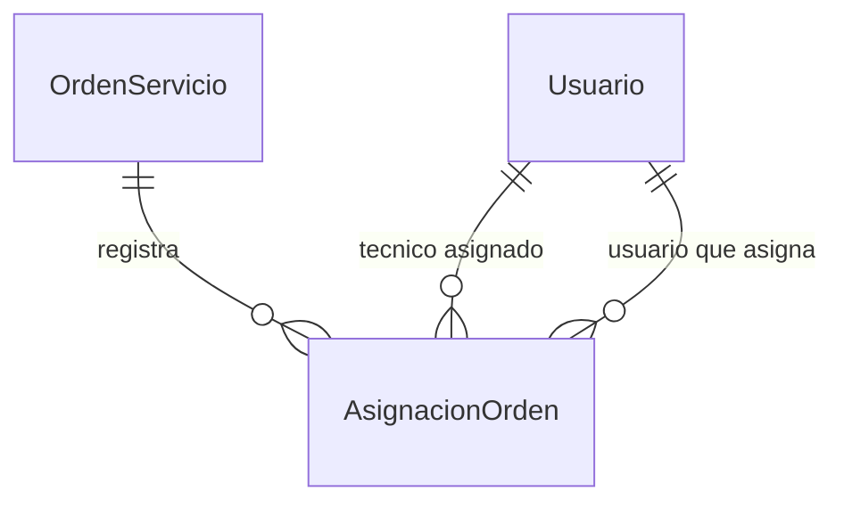

# Órdenes de servicio: recepción y seguimiento

Esta entrega conecta el ingreso de órdenes, su listado con filtros, el expediente,
el historial, la asignación de técnicos y la cancelación. El número se genera en
SQL Server (`TC-1`, `TC-2`, etc.) y la persona que registra cada operación se obtiene
de la sesión. El cliente se obtiene del equipo seleccionado.

Versión compatible con el frontend del commit `4cafbf7`, más el alta de usuarios
del parche 15 y las correcciones de sus scripts 13/14. Conserva el diseño y la
protección de rutas existentes; no requiere incorporar la actualización visual
posterior de GitHub. La API y los scripts de Órdenes son los mismos de la entrega 18.

## Aplicación sobre el proyecto actual

1. Guardar `18_Ordenes_API_v2.patch` en la raíz de TechCare. En la terminal de IntelliJ,
   ubicada en esa misma carpeta, ejecutar:

   ```bash
   git apply --check 18_Ordenes_API_v2.patch
   git apply 18_Ordenes_API_v2.patch
   ```

2. El parche incorpora `16_Ordenes_Procedimientos.sql` y `17_Pruebas_Ordenes.sql` en
   la raíz del proyecto. En SSMS, abrir y ejecutar completo el **16 una vez** en
   la instancia habitual de TechCare. No requiere ejecutar nuevamente 01 ni 02.
3. Ejecutar completo el **17** para verificar las 30 pruebas en la instancia real.
   Los casos revierten sus datos; pueden quedar huecos normales en identidades y
   en la secuencia de números. Usar la base de desarrollo sin escrituras concurrentes.
4. Reiniciar el backend con la configuración DB_URL habitual y abrir el frontend.
   No se agregan dependencias ni se cambian las credenciales, el POM o el maestro 01.

El parche modifica código; la actualización de la base se realiza en el paso 2.
Después, las operaciones cotidianas se realizan desde la aplicación.
Cada integrante que tenga una base propia aplica el 16 a esa base una vez.
Una instalación nueva ejecuta también las actualizaciones previas 06, 08, 11 y 13.

## Cómo comprobarlo desde la interfaz

1. Iniciar sesión con ADMIN o RECEPCION. Abrir Órdenes → Nueva orden.
2. Elegir cliente y equipo activos, describir la falla y seleccionar prioridad.
   La fecha estimada es opcional y se ingresa en hora de Guatemala.
3. Revisar y confirmar. Aparecerá el expediente con un número `TC-…`, estado
   RECIBIDO, recepción registrada a nombre del usuario y el evento inicial.
4. Usar Asignar técnico. Aparecen cuentas y empleados activos con el rol TECNICO.
   La asignación se registra en el historial y conserva el estado RECIBIDO.
5. Entrar con ese técnico: debe ver la orden. Otro usuario que solo tenga rol
   TECNICO no debe verla en el listado ni consultar su ID o historial.
6. Desde ADMIN o RECEPCION, reasignar antes del diagnóstico y comprobar ambos
   eventos en Historial. El técnico anterior deja de tener acceso.
7. Cancelar una orden de prueba con motivo. Conserva su número y sus eventos;
   una orden cancelada no admite nuevas asignaciones ni otra cancelación.

## Permisos

| Rol | Consulta | Crear | Asignar / reasignar | Cancelar |
|---|---|---|---|---|
| ADMIN | Todas | Sí | Sí | Sí, según estado |
| RECEPCION | Todas | Sí | Sí | Sí, según estado |
| TECNICO | Sus órdenes | No | No | No |
| CAJA | Todas | No | No | No |
| BODEGA | Sin acceso a este módulo | No | No | No |

Los roles se acumulan: una cuenta TECNICO + CAJA tiene la consulta general de CAJA.
Los permisos se comprueban en Spring Security y SQL. El historial de Equipos usa
el mismo filtro de órdenes, para conservar esta restricción también en esa pantalla.
El acceso directo a rutas del frontend respeta los roles de la navegación.

La reasignación se permite en RECIBIDO o DIAGNOSTICO mientras todavía no exista
un diagnóstico registrado. Después se conserva el responsable histórico.
Una asignación enviada desde una pantalla desactualizada devuelve 409; no sustituye
silenciosamente al responsable elegido por otra persona.
La cancelación usa las transiciones de SQL; no existe un endpoint para saltar
libremente a REPARACION, LISTO o ENTREGADO.

## API

| Método | Ruta | Uso |
|---|---|---|
| GET | `/api/ordenes` | Listado autorizado y filtros |
| POST | `/api/ordenes` | Registrar ingreso; devuelve 201 y Location |
| GET | `/api/ordenes/{id}` | Recepción, responsable y datos técnicos existentes |
| GET | `/api/ordenes/{id}/historial` | Eventos de estados y asignaciones |
| PUT | `/api/ordenes/{id}/tecnico` | Asignar o reasignar con control de concurrencia |
| POST | `/api/ordenes/{id}/cancelacion` | Cancelar con motivo |
| GET | `/api/ordenes/catalogos/estados` | Estados vigentes |
| GET | `/api/ordenes/catalogos/prioridades` | Prioridades vigentes |
| GET | `/api/ordenes/catalogos/tecnicos` | Técnicos activos; ADMIN/RECEPCION |

Filtros: `buscar`, `estado`, `prioridad`, `tecnicoId`, `desde`, `hasta`.
`tecnicoId=0` significa sin asignar. Desde/hasta reciben `YYYY-MM-DD` y se convierten
en el rango UTC correspondiente al día completo en Guatemala. La búsqueda usa
texto literal, incluyendo `%` y `_`, y las consultas JDBC son parametrizadas.

Crear recibe `{equipoId, problema, prioridad, fechaEstimada?, observaciones?}`.
`fechaEstimada`, cuando existe, debe tener zona horaria ISO, por ejemplo
`2026-12-31T10:15:00-06:00`. No se acepta un número de orden ni un actor del cliente.
Asignar recibe `{tecnicoId, tecnicoAnteriorId, observacion?}`; `tecnicoAnteriorId`
es null para la primera asignación. Cancelar recibe `{motivo}`.
Las respuestas de Órdenes usan camelCase y fechas ISO UTC. Los datos de acceso
como PasswordHash no forman parte del DTO. Las escrituras requieren CSRF.

## Cambios en la base

El 16 incorpora una secuencia que conserva su avance al repetir el script,
la tabla AsignacionOrden (eventos inmutables), su índice y trigger, una vista de
consulta, una función de permisos y los procedimientos de API. No altera las
tablas originales ni reescribe órdenes, diagnósticos o reparaciones anteriores.
En órdenes anteriores sin asignaciones, el técnico se obtiene de su reparación
o diagnóstico. No requiere asignar de nuevo las órdenes históricas.

AsignacionOrden tiene AsignacionID como PK y FK a OrdenServicio, al Usuario técnico
y al Usuario que asigna. Guarda Fecha UTC y Observacion de hasta 500 caracteres.
Una orden admite varios eventos; su última asignación determina el responsable
antes del diagnóstico. Cada usuario puede participar en varios eventos.
La tabla adicional se incluye en el siguiente diagrama del módulo:



## Alcance y validación

Registrar diagnósticos, reparaciones, repuestos, facturas, pagos y entregas desde
la aplicación se integra en las siguientes etapas. El expediente ya consulta los
diagnósticos y reparaciones existentes; los demás apartados indican su estado pendiente.
Modificar los roles de cuentas existentes continúa pendiente y no se incluye aquí.

Verificación local: compilación TypeScript/Vite y pruebas de navegador con HTTP
simulado, con revisión visual en escritorio y móvil; 100 pruebas Java aprobadas,
incluidas 30 de Órdenes, con JDBC simulado; análisis de sintaxis T-SQL de 16 y 17.
No se ejecutó SQL Server en este entorno. Los 30 casos del 17 deben ejecutarse
en la instancia real antes de considerar validada la integración con la base.

```bash
cd backend
./mvnw test
cd ../frontend
npm run build
```

No se hizo commit ni push. Después de validar la base y la aplicación, un mensaje
de commit adecuado es: `Se integra la recepción y gestión de órdenes de servicio`.
